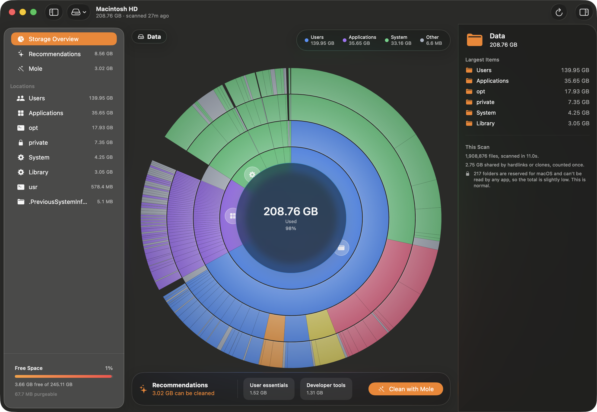

# Disker

**Find out where your disk space went, and get it back.**

Disker measures everything on your Mac and draws it as a chart you can click through, so the
thing quietly eating 40 GB is obvious in a couple of clicks instead of buried ten folders deep.
Then it points out what is actually safe to delete.



## What you get

- **A picture of your whole disk.** Every folder sized in one pass, drawn as a sunburst where
  the size of a slice is the space it uses.
- **Click to explore.** Click any slice to zoom into it, and the panel on the right shows what
  is biggest inside. Follow the breadcrumb back out.
- **Suggestions you can trust.** Caches, build leftovers, old installers — sorted by how safe
  they are to remove, with the risky ones marked for review rather than mixed in.
- **One-button cleanup.** Hand the job to [Mole](https://github.com/tw93/mole) without leaving
  the window, or delete things yourself. Everything goes to the Trash, and ⌘Z puts it back.

## Install

1. **[Download the latest release](https://github.com/mohammad-malik/disker/releases/latest)**
   and unzip it.
2. Drag `Disker.app` to your Applications folder.
3. **Right-click it and choose Open** the first time. A normal double-click will be refused —
   the app isn't notarised by Apple, so macOS asks once. After that it opens normally.

You'll also want to give it **Full Disk Access** in System Settings. Without it Disker can't see
everything and will tell you its total is incomplete — and the scan gets *much* slower, because
macOS spends around twenty seconds deciding about each folder it isn't allowed into. If a scan
seems to hang, this is almost always why.

[Full instructions →](docs/INSTALL.md)

**Needs macOS 26 (Tahoe) on an Apple Silicon Mac.** Cleanup uses
[Mole](https://github.com/tw93/mole) (`brew install mole`), which is optional — everything else
works without it.

## Using it

Disker scans your startup disk when you open it — a few seconds for a full volume — and
remembers the result, so it opens instantly next time. Press ⌘R whenever you want fresh numbers.

- **Click a slice** to zoom in; use the breadcrumb at the top to come back out.
- **Switch disks** with the drive button in the toolbar.
- **Recommendations** in the sidebar groups what's worth removing by how safe it is, with the
  biggest wins at the top of each group.
- **Clean with Mole** opens the cleanup options. Start with **Preview** — it shows exactly what
  would be removed without touching anything.

## Is it going to delete something important?

Not on its own. Disker never removes anything unless you tell it to, and there is no
"clean everything" button that runs without showing you the list first.

When you do delete something:

- **It goes to the Trash**, not straight to oblivion. ⌘Z undoes it.
- **Installed software is never suggested.** Disker knows the difference between a project's
  `node_modules` and the folder your globally installed command-line tools live in, and won't
  offer the latter.
- **It won't touch the inside of an app.** Nothing within a `.app` is ever offered for deletion.
- **It respects your Mole whitelist**, so anything you've already told Mole to protect stays
  protected.

If you'd rather not run a downloaded binary that reads your entire disk — a fair position —
[build it from source](#building-from-source). It takes two commands and no Apple developer
account.

## Building from source

You need the Command Line Tools for Xcode. Xcode itself is not required.

```sh
./Tools/create-signing-identity.sh   # once, so Full Disk Access survives rebuilds
./Tools/bundle.sh                    # produces build/Disker.app
./Tools/test.sh                      # runs the test suite
open build/Disker.app
```

## Documentation

| | |
| --- | --- |
| [Installing](docs/INSTALL.md) | Requirements, first launch, Full Disk Access, uninstalling |
| [How it works](docs/ARCHITECTURE.md) | Architecture and implementation notes for contributors |
| [Third-party software](docs/THIRD-PARTY.md) | Mole's licence and where the boundary sits |
| [Changelog](CHANGELOG.md) | What changed in each release |

## Status

Working end to end: scanning, the chart, recommendations, deletion with undo, and the full Mole
configuration and run flow. Treemap view, search, and duplicate detection are not built yet.

## License

[PolyForm Noncommercial 1.0.0](LICENSE.md) — **free for any noncommercial purpose, but not for
profit.** Personal use, hobby projects, research, education, and use by nonprofit and government
organizations are all fine, including changing it and sharing it. Selling it, or building it
into a commercial product or service, is not.

This is deliberately not an open-source licence by the OSI definition, since it limits who may
use the software and for what.

[Mole](https://github.com/tw93/mole) is GPL-3.0-or-later, and Disker neither includes nor
distributes it — it runs the copy on your own machine as a separate program. See
[docs/THIRD-PARTY.md](docs/THIRD-PARTY.md).
